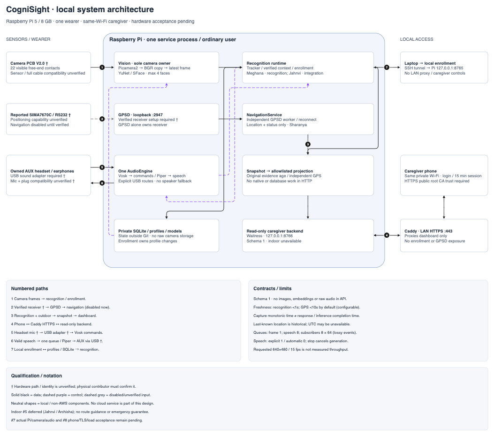

# CogniSight system architecture

This is the implemented local-Pi design for issues #2, #3, #4 and #6, following the user's approval of #6/#7 on 12 November 2026. It does not establish successful physical qualification or separate approval by every module owner. Indoor issue #5 remains deferred.



Open the [editable draw.io file](system/cognisight-architecture.drawio) in diagrams.net to change the diagram. The [generator](system/generate_architecture.py) uses [helpers](system/diagram_helpers.py) adapted from the user's architecture-diagram skill. Regenerate from the repository root:

```sh
python3 docs/system/generate_architecture.py
```

The generator validates XML and edge endpoints. The checked PNG was rendered with the official diagrams.net viewer and visually inspected for labels, arrows and clipping. Regenerating the XML does not automatically refresh the PNG; export and inspect it again after diagram edits. All shapes are neutral because the project has no AWS services. The draw.io connector was not exposed in this session; the editable file was generated locally. No source/reference architecture image was supplied.

## Boundaries and flows

| Path | Implemented boundary |
| --- | --- |
| 1 | One Picamera2 owner supplies owned BGR frames through a capacity-one mailbox. Runtime serializes recognition and enrollment inference. |
| 2 | An independently owned local GPSD client validates location/status. The reported SIMA7670C/RS232 board is not yet proven to provide positioning, so leave navigation disabled. |
| 3 | Recognition and outdoor evidence enter the runtime snapshot and caregiver allowlist. Original capture/receiver age governs expiry; HTTP success does not renew evidence. Last-known position remains historical. |
| 4 | One caregiver phone on the same Wi-Fi uses authenticated HTTPS through Caddy. Only the read-only dashboard backend is proxied. |
| 5 | A verified USB microphone route feeds offline Vosk commands. The owned AUX headset needs a compatible USB sound adapter and verified microphone. |
| 6 | One bounded speech queue feeds Piper and the explicit USB output. Automatic speech expires with visibility; explicit speech uses existing recency rules. Stop invalidates the generation. |
| 7 | Local enrollment is available through a loopback-only SSH tunnel. Verified profiles and private SQLite state supply recognition/context. |

Read [module contracts](system/CONTRACTS.md) for actual schema-1 fields, time/error semantics, queue bounds, ownership and extension rules. There is no second camera consumer, indoor producer, message broker, cloud inference, walking-route service or emergency guarantee.

## HTTP and shutdown limits

Each localhost Waitress server uses two request threads, connection limit 32, backlog 32, inactive channel timeout 30 seconds, cleanup interval 5 seconds, and 16 KiB request-header/body limits. These use the [documented Waitress 3 options](https://docs.pylonsproject.org/projects/waitress/en/stable/arguments.html). The suite includes an actual installed-`Adjustments` check; it remains dependency-skipped on this development host and must run in CI/on the Pi. Inactivity timeout is not a total request execution deadline.

Runtime stop cancels work and attempts every device owner. HTTP listeners/channels/workers stop before SQLite closes. A failed device cleanup latch prevents closing the database beneath a remaining owner; a worker exception during requested shutdown is a failure. Audio retains live workers so `start()` cannot create duplicate owners. The service unit allows 90 seconds for sequential shutdown joins instead of the old 15 seconds. Python cannot bound every native close call; systemd may ultimately terminate the service group. Actual stop/reboot behavior still needs measuring on the Pi.

## Assumptions and physical acceptance

Diagram daggers mark unverified hardware identity or paths: exact camera sensor/cable compatibility, positioning capability/interface, and USB adapter/microphone compatibility. The free ribbon end had 22 visible contacts; the camera-side end was hidden. The AUX headset is owned; the required USB adapter is not yet selected. No guessed RS232/GPIO wiring or modem commands are provided.

The Pi is reported as Pi 5/8 GB, Raspberry Pi OS 64-bit, SSH user `jahnvi`, hostname `cognisight`; installed OS release/Python and actual IP are pending. Use the [simple SSH runbook](hardware/PI-RUNBOOK.md) and [hardware evidence checklist](hardware/README.md). Source coverage includes the physical endpoints, single device owners, SQLite/models, all seven paths, loopback/LAN ports, control versus data arrows, schema/freshness/queue rules, module owners and deferred indoor state.

See [validation](VALIDATION.md) for exact software results and unmeasured hardware/load/phone gates. Do not close #7 or #8 merely because this diagram or passing software tests exist.
